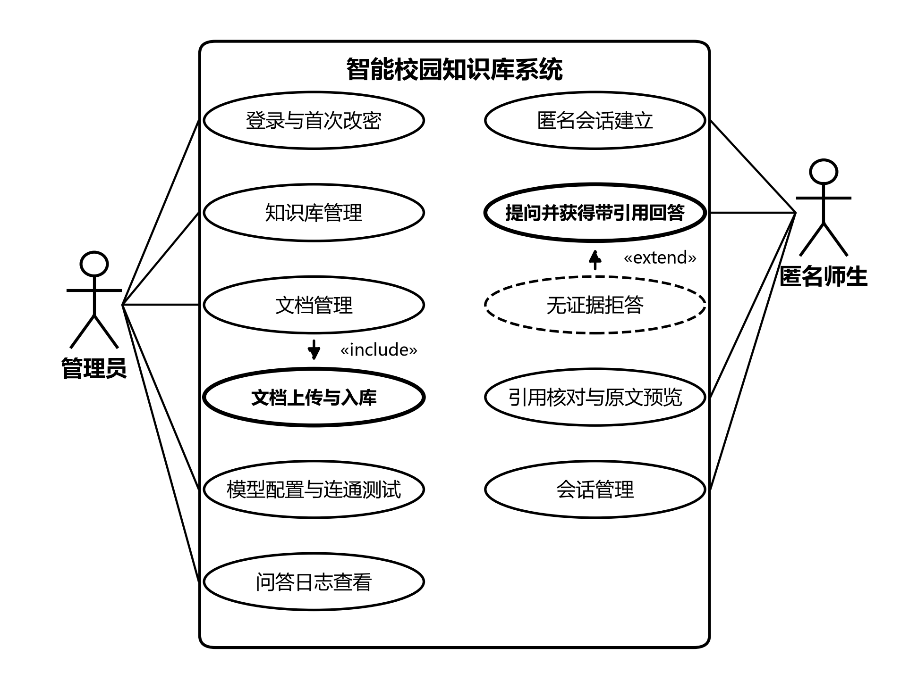

# 第3章 系统需求分析

本章从可行性、功能性需求、非功能性需求与用例四个方面界定系统需要解决的问题与质量要求,为第4章设计提供依据。

## 3.1 系统可行性分析

技术可行性。系统的三项核心能力——多格式文档解析入库、知识切片混合检索、大语言模型流式生成——所依赖的技术均已在第2章说明,并各有成熟实现;工程上 FastAPI、异步 SQLAlchemy、Vue 3 与 PostgreSQL 均为主流开源框架,嵌入模型与 Qdrant 承担向量化与近邻检索,模型服务经开放兼容协议接入。系统已按上述技术完成开发并跑通从上传入库到带出处引用回答的完整链路,实现本系统不存在原理性障碍。

操作可行性。管理端围绕浏览器界面组织:管理员登录后强制修改初始口令,知识库与切块模板通过表单维护,文档上传只需选择文件与目标知识库,进度连续呈现,失败文档可重新处理,全程无需接触命令行。聊天端打开即用:进入会话页时系统自动分配匿名标识,输入自然语言问题即可获得回答,不需要注册登录。高频操作一至两步内可达,统一壳层使页面位置固定,常规使用不需要专门培训。

经济可行性。系统全部选用开源组件:FastAPI、Vue 3、PostgreSQL、Qdrant 以及中文分词工具等均无授权费用,不存在商业授权支出。部署为单机容器化编排,存储开销随文档规模线性增长,校园现有服务器即可承载;嵌入模型可在普通硬件上轻量运行,生成模型可调用开放接口或按需本地部署,经费投入下限接近于零,具备持续运行条件。

## 3.2 功能性需求

按使用者划分,功能性需求分为管理端与聊天端两部分:管理端负责知识的组织与入库,聊天端负责知识的消费,两端共用同一套检索与生成链路。

### 3.2.1 管理端功能需求

在身份认证方面,管理员以账号口令登录并维持会话,系统只设一名管理员,口令散列保存,首次登录强制修改初始口令后方可使用其余功能,凭证以令牌方式随请求携带,退出后失效。

在知识库管理方面,管理员创建、修改、删除知识库并指定切块模板,系统保存名称、描述与模板设置,删除时级联清理其下文档、知识切片与向量点。切块模板决定文档拆分为知识切片的方式,管理员可在通用句级流式、章节独立、问答对与整篇间选择,模板不适用时自动回退通用模板。

在文档管理方面,管理员上传 PDF、DOCX、TXT、Markdown、CSV、Excel、PPT、HTML 与图片等格式的文档,单个不超过 50MB,系统校验格式与大小后受理并置为待处理;后台工作线程依次完成解析、按模板切块、可选的入库增强与向量化,进度即时写回并展示,处理失败可重新处理,重新处理重建切片并清理旧向量点,保持两侧对应。管理员可查看文档状态、下载与预览原文件,删除文档时同步清除其切片与向量。

在模型配置方面,管理员维护多套模型配置并随时切换:系统以配置档案形式保存嵌入、生成、视觉与重排四类服务的地址与参数,支持增删改与启用切换,切换时热替换运行中的服务连接而无需重启;每套配置可执行连通性测试,系统发起真实调用并返回结果与错误信息。相似度阈值、候选数量、融合权重等 RAG 参数同样由管理员读写,保存即热更新。

在运行状态与日志方面,系统提供存活与就绪检查,覆盖 PostgreSQL、Qdrant 与模型服务;问答日志按时间列出历史提问、命中切片与耗时分项,供管理员研判检索效果并调整参数。

### 3.2.2 聊天端功能需求

在会话建立方面,师生无需注册即可使用:进入会话页时系统生成并下发匿名客户端标识,提问、会话与消息记录均归属于该标识,系统不收集用户真实身份信息;首条消息自动创建会话,后续提问沿用同一会话。

在提问与回答方面,用户以自然语言提问并尽快看到回答,系统受理前校验所选知识库存在、启用且含有已完成入库的文档,不满足时以可读消息告知;受理后经混合检索获取相关知识切片,按「来源 N」编号拼入提示词交由大语言模型生成,并以服务器推送事件把开始、增量文本、检索来源、完成与错误等事件逐段推送给前端,用户在生成过程中即看到回答逐渐出现,这是流式回答的需求含义。检索不到相关证据时系统拒绝作答,回应中注明未找到依据。

在引用与核对方面,用户要求回答中的论断可回查原文,系统为回答标注引用编号并返回对应知识切片的文档名与位置,前端把引用标记渲染为可点击元素,点击后在弹层中内联预览原始文件;来源列表随来源事件先行推送,先于回答完成呈现。

在会话管理方面,用户查看历史会话、继续旧会话提问、重命名与删除会话,系统按匿名标识返回列表与消息详情,支持新建与改名,删除采用软删除,会话在列表中消失但数据保留,避免误删丢失。

## 3.3 非功能性需求

性能方面,系统面向校园日常使用场景,入库进度按解析、切块、增强、向量化等阶段逐段提交,问答采用流式输出,候选经过融合、过滤和截断后再进行生成,以减少无效处理。本文主要验证功能流程,不展开大规模并发性能测试。

安全性方面,管理端全部接口经身份校验,口令强散列保存并加盐,首次登录强制改密;聊天端匿名标识只用于会话归属,不含身份信息,各标识的会话相互隔离。接口参数经数据模型统一校验,删除区分会话软删除与文档、知识库硬删除的语义;模型接入密钥等敏感配置存放于环境变量与本地配置文件,不随代码分发。

易用性方面,界面结构统一、路径简短:顶栏导航与管理页二级标签使功能分区固定,处理进度与错误信息直观反馈,回答按 Markdown 渲染且引用可点击预览;聊天端不设注册登录环节,从进入页面到提出第一个问题只需一次输入。

可维护性方面,系统按「路由—服务—RAG 管线」分层,各层职责单一,替换模型服务或调整检索环节不牵动其他层;请求与响应的数据模型同数据库模型分离,表结构变更影响可控;模型与 RAG 参数集中于配置文件并支持热更新,修改后即生效。知识切片采用不可变约定,切片标识即向量点标识,重新处理时整体重建,便于排查两侧不一致问题;附带独立测试脚本与容器化编排,依赖环境可按文档复现。

## 3.4 用例分析

系统有管理员与匿名师生两类参与者,前者负责知识的组织与入库,后者负责知识的消费,二者的目标不同,所涉及的用例也不相同。图3-1按统一建模语言的用例图约定给出系统的整体用例视图:矩形表示系统边界,椭圆表示用例,小人表示参与者,实线表示参与者与用例之间的关联,带箭头的虚线表示用例之间的包含与扩展关系。

图3-1 系统用例图

从图中可以看出,管理员一侧有登录与首次改密、知识库管理、文档管理、模型配置与连通测试、问答日志查看五个用例,覆盖身份凭证、知识组织与运行维护三个方面,其中文档管理通过包含关系复用文档上传与入库,后者承担格式与大小校验、解析、切块、可选增强与向量化等步骤,是管理员侧最重的一条路径。匿名师生一侧有匿名会话建立、提问并获得带引用回答、引用核对与原文预览、会话管理四个用例,覆盖从进入会话页到回查出处的完整闭环,无证据拒答作为提问用例的扩展分支出现,只在检索不到达到阈值的证据时触发,正常回答与拒答由此构成互斥的两条出口。两类参与者之间没有继承或包含关系:管理员以令牌访问管理端,师生以匿名标识直接进入会话页,两条链路在用例层面互不交叠,仅原文件的预览接口对两端同时开放。

图中以橙色标出的两个用例是系统的主干,分别对应知识的入库与消费两端,其余用例围绕它们展开。下面分别说明两个核心用例,用例中的参与者、前置条件、基本事件流、扩展事件流与后置条件统一整理为表3-1。

### 3.4.1 管理员上传文档并入库

该用例由管理员发起,目标是把一份校园资料转换为可以检索的知识切片。管理员先选择知识库并上传文件,系统完成格式和大小检查后建立文档记录;后台任务再完成解析、切块、增强和向量化。处理成功后,文档状态变为已完成,聊天端即可检索其中的内容。文件格式不支持或处理失败时,系统返回提示,管理员可以重新处理。

### 3.4.2 匿名用户提问并获得带引用回答

该用例由匿名师生发起,目标是根据已入库资料获得可核对的回答。用户提交问题后,系统同时进行向量检索和关键词检索,将候选结果融合、过滤并补充相邻切片,再交给大语言模型生成回答。回答返回来源编号,用户可以查看来源列表并预览原文件;没有达到阈值的相关切片时,系统直接拒答。

表3-1 核心用例描述

| 项目 | 用例一:文档上传与入库 | 用例二:匿名提问并获得带引用回答 |
| --- | --- | --- |
| 参与者 | 管理员 | 匿名师生 |
| 前置条件 | 管理员已登录并完成首次改密,目标知识库已创建并指定切块模板,数据库与向量库已初始化 | 至少存在一个启用且含有已完成文档的知识库,嵌入与生成服务配置可用,用户已取得匿名客户端标识 |
| 基本事件流 | 管理员选定知识库上传一份不超过 50MB 的文档,系统校验格式与大小后受理,保存原文件并把记录置为待处理;后台线程领取任务,依次完成解析、按模板切块、可选增强与向量化,进度按阶段写回,处理完毕状态转为已完成 | 用户输入问题并发送,系统校验知识库可用后受理,问题经向量化、双路检索、加权融合、阈值过滤、可选重排与邻块扩展后拼装为带来源编号的上下文,由大语言模型生成回答并逐段推送 |
| 扩展事件流 | 格式或大小不通过时在写盘之前拒绝,不建立文档记录;处理失败累计三次后置为失败并保留错误信息,管理员可发起重新处理,系统清理旧切片与旧向量点后重建 | 过滤后没有任何候选达到阈值时不调用生成模型,直接返回注明未找到依据的拒答内容 |
| 后置条件 | 切片与向量均已写入且一一对应;执行过重新处理时库中只保留重建后的结果 | 该次问答及命中来源写入问答记录,回答带有可点击核对的出处引用,首条消息对应的会话自动建立并归属当前匿名标识 |

表中前两行界定谁在什么条件下发起用例,中间两行给出正常路径与异常路径,末行给出可验收的结果状态,分别与3.2节的功能需求和3.3节的质量要求对应。用例一的基本事件流是4.5节入库流程设计的依据,用例二的基本事件流则对应4.4节的检索流程设计,两者的环节划分与参数取舍将在第4章展开。

## 3.5 本章小结

本章完成了系统的需求分析。可行性分析表明系统技术成熟可得、操作贴合两类使用者、成本可控;功能性需求按管理端与聊天端界定了登录认证、知识库与文档管理、模型配置、匿名会话、流式回答与引用核对的职责;非功能性需求提出性能、安全性、易用性与可维护性四方面要求;两个核心用例刻画了文档入库与带引用问答的完整交互。上述需求将在第4章转化为架构、模块、数据库与流程设计。
