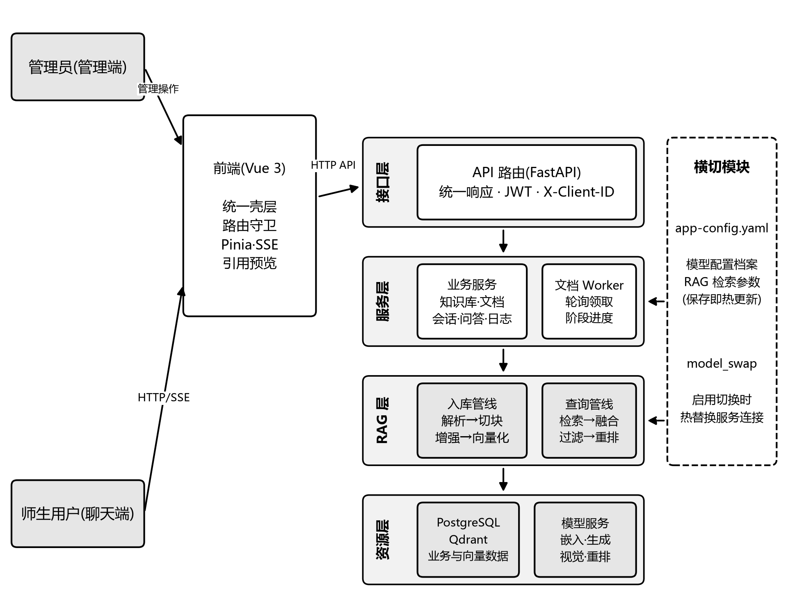
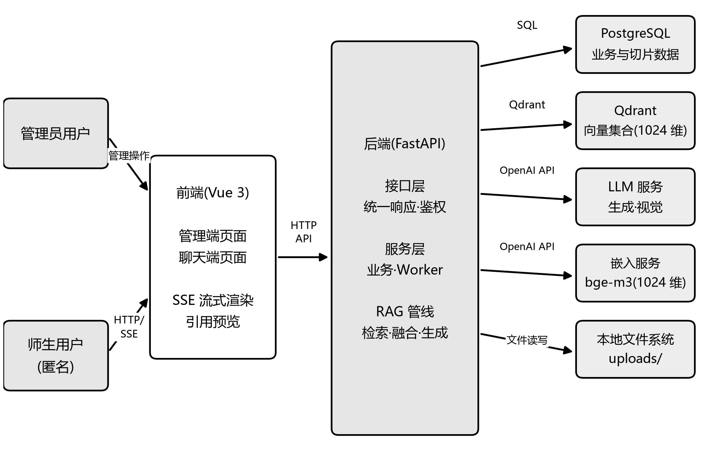

# 第4章 系统设计

本章把第3章的需求转化为可落实的技术方案,依次给出总体架构、功能模块、数据库、检索流程与入库流程的设计,每项设计均说明取舍理由。

## 4.1 总体架构设计

系统采用四层结构组织:接口层、服务层、RAG管线层与外部资源层,请求自接口层进入,逐层下传至存储与模型,处理结果沿原路返回。整体结构见图4-1。

图4-1 系统总体架构图

接口层由 app/api/routes 下的路由模块组成,负责解析参数、校验凭证并统一包装响应:管理端路径前缀校验 Bearer 令牌,聊天端路径校验 X-Client-ID 头,所有业务接口一律返回包含成功标志、数据负载与提示信息的三段式结构,前端只需按一种格式处理错误。服务层承载业务规则,知识库与文档的增删改、会话归属与消息落盘、问答记录写入、后台任务领取都在这一层完成,数据访问经异步 SQLAlchemy 会话执行。

RAG管线层与使用者身份无关,对上只暴露查询与入库两个入口:查询入口接受问题与知识库标识,返回带引用的答案或事件迭代器;入库入口接受解析后的文档块,产出切片与向量。解析分派、切块、嵌入、检索、融合、重排与提示词拼装全部收敛在该层内部。外部资源层包含 PostgreSQL、Qdrant 与遵循开放兼容协议的模型服务,模型按嵌入、生成、视觉、重排四类角色接入。

分层的直接收益是变更隔离:第3章可维护性需求要求替换模型服务或调整检索环节不牵动其他层,四层结构把这一要求落在边界上,模型切换只改服务连接的装配,检索参数只改运行期配置对象,接口层的校验与鉴权保持不变。

横切模块有两个。app/core/app_config.py 统一读写项目根的 app-config.yaml,其中保存多套模型配置档案与一个启用指针,以及相似度阈值、候选数量、融合权重等检索参数;设置页的增删改与启用切换均落盘该文件,切换启用档案时由 app/services/model_swap.py 热替换运行中的服务连接,保存检索参数则即时写入运行期配置对象,均不需重启进程,回应了3.2.1中保存即生效的需求。

前后端分离体现在两个工程与两套凭证上:前端为 Vue 3 单页应用,开发期由构建工具代理接口请求,生产环境由 nginx 统一反向代理;管理端凭证为 JWT,聊天端凭证为 X-Client-ID,按路径前缀分流。部署形态分两档:日常开发只编排 PostgreSQL 与 Qdrant 两个容器,前后端在本机进程运行;完整形态构建后端、前端与 nginx 三个容器,对外仅暴露 80 端口。

## 4.2 功能模块设计

管理端围绕知识的组织与入库划分为五个模块。认证模块位于 /api/auth,提供登录、首次改密、身份读取、退出与主动改密,系统只维护一名管理员,口令强散列保存,强制改密标志未清除时其余管理接口一律拒绝,对应3.2.1的身份认证需求。知识库模块位于 /api/knowledge-bases,承担增删改查,创建时须选定切块模板,删除采用硬删除并级联清理其下文档、切片与向量点。文档模块位于 /api/documents,提供列表、上传、详情、删除、状态查询与重新处理,上传只做格式与大小校验即受理并置为待处理,解析入库交由后台线程执行;原文件的下载与内联预览由 /api/files 提供,该路径对聊天端同样开放,以便引用弹层直接显示原文。

模型配置模块位于 /api/admin,包含配置档案的增删改与启用切换、连通性测试以及检索参数读写,测试会发起一次真实调用并回传结果或错误,使管理员在切换前确认地址与密钥有效。日志模块同在 /api/admin,按时间倒序列出问答记录及其命中切片、耗时分项与当时的检索参数,供对照检索效果调整阈值与候选数量。

聊天端围绕知识的消费划分为三个模块。会话模块由 /api/chat/session 下发匿名标识,/api/conversations 在其下提供列表、创建、详情、改名与删除,删除为软删除,记录保留但列表不再显示,满足3.2.2中匿名归属、误删可防的要求。问答模块即 POST /api/chat,受理前依次校验消息长度、知识库可用与管线就绪,不满足时以可读错误码返回;受理后以服务器推送事件输出开始、增量文本、检索来源、完成与错误五类事件,来源事件先于回答完成到达。引用预览模块复用文件接口,把引用标记对应的原始文件在弹层中内联显示,用户在生成过程中即可开始核对。

模块之间是单向依赖:文档模块产出的切片是问答模块的检索语料,模型配置模块决定问答与入库所用的服务连接,日志模块消费问答记录,认证模块为管理端提供统一凭证校验,同一套RAG管线因此同时服务两端。系统组件及其交互关系见图4-2。

图4-2 系统组件与交互关系

## 4.3 数据库设计

数据库设计遵循三条约定:请求与响应的数据模型同 ORM 模型分离,表结构变更的影响被限制在服务层;时间字段使用带时区的日期时间并以当前 UTC 时刻为默认值;删除语义按对象区分,会话为软删除,文档与知识库为硬删除并级联清理关联数据,与3.2.2和3.3的安全性需求一致。主要数据表及其职责如表4-1所示。

表4-1 主要数据表及职责

| 表名 | 职责 | 核心字段 | 主要关联 |
| --- | --- | --- | --- |
| admin | 唯一管理员的身份凭证 | username、password_hash、must_change_password、last_login_at | 独立成表,固定一行 |
| knowledge_bases | 知识库及其切块方式 | name、is_enabled、chunk_template | 被 documents、conversations 引用 |
| documents | 上传文件与处理状态 | knowledge_base_id、storage_path、file_hash、status、progress、attempt_count | 属于 knowledge_bases,统领 document_chunks |
| document_chunks | 知识切片原文与位置 | document_id、chunk_index、content、page_number、metadata_json | 属于 documents,主键即向量点标识 |
| conversations | 匿名会话 | id、client_id、knowledge_base_id、title、is_deleted | 按 client_id 归属,下挂 qa_records |
| qa_records | 单次问答全量记录 | conversation_id、question、answer、similarity_threshold、latency_ms | 属于 conversations,下挂 qa_sources |
| qa_sources | 该次问答命中的切片 | qa_record_id、chunk_id、similarity_score、source_order | 级联删除于 qa_records |

围绕表4-1补充两点关系。documents 以 knowledge_base_id 外键挂在知识库之下,document_chunks 再以 document_id 外挂在文档之下,形成知识库、文档、切片的三级归属,删除时沿这条链级联清理,切片与向量点不会残留。conversations 按 client_id 建索引,qa_records 以会话标识加轮次序号记录每次问答,qa_sources 经外键挂在记录之上并标注命中次序与相似度,随父记录级联删除;问答记录以切片标识留存命中关系而不指向切片内容,即使切片因重新处理被重建,历史日志仍能还原当时命中情况。

向量侧只设一个集合 campus_rag_chunks_v1,维度 1024,距离度量为 COSINE,与嵌入模型输出口径一致。约定切片表主键即向量点标识,一行对应一个向量点,向量点负载写入切片、文档、知识库标识与页码,使检索命中后无需回表即可完成知识库过滤。重新处理时切片整体重建,新标识写入新向量点,旧标识的点与行在新数据就绪后一并清除,任意时刻两侧一一对应。

## 4.4 RAG 检索流程设计

检索流程把一次提问处理为带引用的回答,链路为:问题向量化、双路检索、加权融合、融合后阈值过滤、可选重排、截断、邻块扩展、上下文拼装与生成,各环节参数的默认取值如表4-2所示。

表4-2 检索与切块参数默认取值

| 参数 | 默认值 | 作用环节 |
| --- | --- | --- |
| candidate_top_k | 8 | 双路检索各自的召回数 |
| vector_weight | 0.7 | 融合时向量路权重,余量归关键词路 |
| similarity_threshold | 0.60 | 融合之后的过滤阈值 |
| final_top_k | 5 | 截断后进入扩展的候选数 |
| chunk_size / chunk_overlap | 600 / 80 | 通用模板的切块目标长度与重叠 |
| auto_keywords / auto_questions | 5 / 2 | 入库增强的关键词与候选问题数,置 0 关闭 |

第一步把问题交给嵌入模型转成 1024 维向量,与集合维度对齐。第二步执行双路检索:向量路在 Qdrant 中按余弦距离取最近的 candidate_top_k 个候选且不设阈值;关键词路由 jieba 分词并附加中文二元切分组合出查询词,再到数据库对切片正文做模糊匹配,同样取 candidate_top_k 个候选。两路并行的理由2.3已述;向量路不设阈值,是因为阈值统一在融合之后执行,提前过滤会使两路口径不一致。

第三步按向量权重 0.7 对两路得分加权融合,仅被单路命中的结果保留原始得分参与排序;校园提问多为语义性表述,向量路主导次序,关键词路作为字面命中的补充。第四步在融合结果上统一做相似度过滤,低于 0.60 的候选剔除;过滤放在融合之后而非检索之内,使关键词路独有的高分命中不因缺少向量得分而提前丢弃。第五步是可选重排:配置了重排服务时,把问题与候选切片交交叉编码模型重新打分,失败则回退融合序,不阻断问答;重排更准但开销大,故只作用于过滤后的小规模候选,回退机制保证了3.3所要求的响应稳定性。第六步按 final_top_k 截断为 5 条。第七步做邻块扩展,对每条命中切片取同一文档的前后各一块补入,补回因切块造成的跨片断文。

第八步把扩展后的材料按「来源 N」编号拼入提示词,上下文总量限制在 4000 token 以内,再以较低温度调用生成模型,由其依据证据作答并标注引用编号;过滤后没有任何候选时直接返回拒答文案,不调用模型,从流程上杜绝脱离材料的编造。生成结束后,该次问答的参数快照、耗时分项与命中切片写入问答记录与来源表,供日志模块研判。

## 4.5 文档入库流程设计

入库流程把一次上传处理为可检索的切片与向量,链路为:上传受理、后台领取、解析分派、按模板切块、可选增强、落库、向量化与写入向量集合。管理员选定知识库上传文件后,接口校验格式与大小(单文件不超过 50MB),通过即保存原文件、写入文档记录并置为待处理后立即返回,耗时的解析不在请求内执行。

处理由常驻的后台工作线程以轮询方式领取:每次以数据库行级锁跳过已被占用的记录,领取时把状态改为处理中并记录占用时间与执行标识,失败重试次数累计,达到 MAX_ATTEMPTS 为 3 次仍失败则置为失败并保留错误信息。采用数据库轮询而非额外中间件,是因为单机部署下待处理文档量小,轮询已足够及时,且任务状态与业务数据同库同事务,省去一套组件的部署与维护。

处理按阶段推进,进度分别在开始处理、解析完成、切块完成、切片落库、向量化完成与全部完成时写回 10、30、40、60、80、100,每阶段即刻提交而非只在结束时写一次,前端因此看到连续变化的进度条,对应3.3中进度逐段提交的要求。解析阶段按文件扩展名分派解析器,PDF 额外检测章节标题,图片走视觉模型做文字识别;解析产出带页码与块类型的内容块,供后续切块与引用定位使用。

切块阶段读取所属知识库的切块模板并分派四种策略。通用模板按句级流式切分,目标长度 600、相邻块重叠 80,允许跨内容块切分,适用于多数说明性文档;章节模板利用解析识别出的标题按章独立切块且不设重叠,适用于结构清晰的制度文件;问答模板把内容整理为问答对,适用于培训题库类材料;整篇模板把全文作为单一切片,估算长度超过嵌入模型安全上限时自动回退通用模板,对应3.2.1的自动回退要求。

增强阶段在启用自动关键词或候选问题时逐片调用生成模型,提取结果写入切片的元数据列,失败则降级为纯正文入库。随后切片以原文写入 PostgreSQL,正文保持纯净,增强内容只存于元数据。向量化阶段经统一的拼装函数把正文与关键词、候选问题合并为嵌入输入,再按批发送给嵌入模型并按配置重试;写入向量集合时以切片主键为点标识,负载写入归属信息。新数据全部就绪后执行换代:删除该文档上一代的切片行与向量点,该删除与新切片写入同事务提交,重建期间旧内容仍可检索。

重新处理在上述链路上等价于一次完整的切片重建:清理旧切片与旧向量点,按当前模板与参数重新切块入库,切片标识随重建更新,两侧同步换代,库中只保留重建后的内容,对应3.2.1中保持两侧对应的验收条件。

## 4.6 本章小结

本章完成了从需求到设计的转化:总体架构以四层结构与两个横切模块实现变更隔离与配置热更新,功能模块按管理端五模块、聊天端三模块划分并明确接口关系,数据库以七张主要表与切片标识即向量点标识的约定打通业务库与向量库,检索流程以双路召回、融合后过滤、可选重排与邻块扩展逐层筛选证据,入库流程以轮询领取、阶段进度、模板切块与换代写入保证切片与向量始终对应。上述设计逐项回应了第3章的需求,具体实现将在第5章展开。
