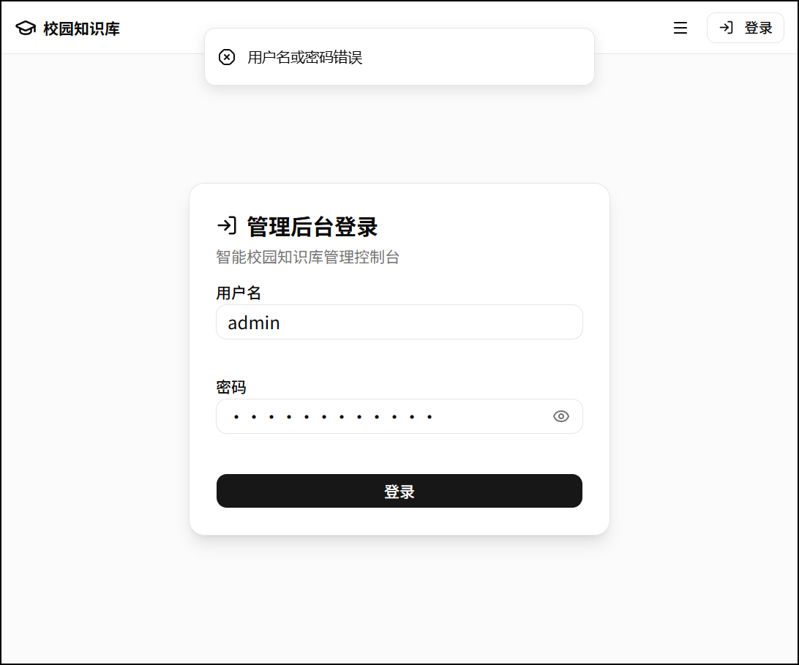
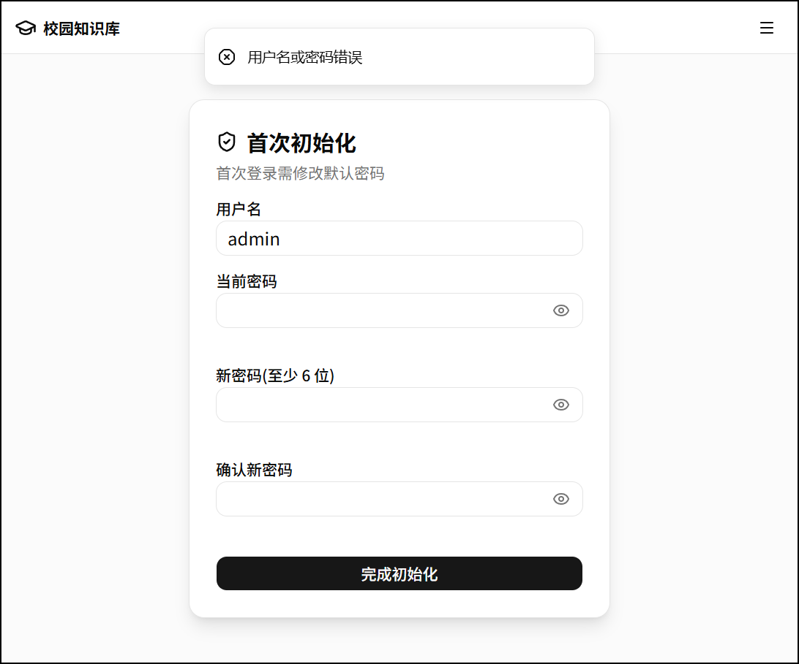
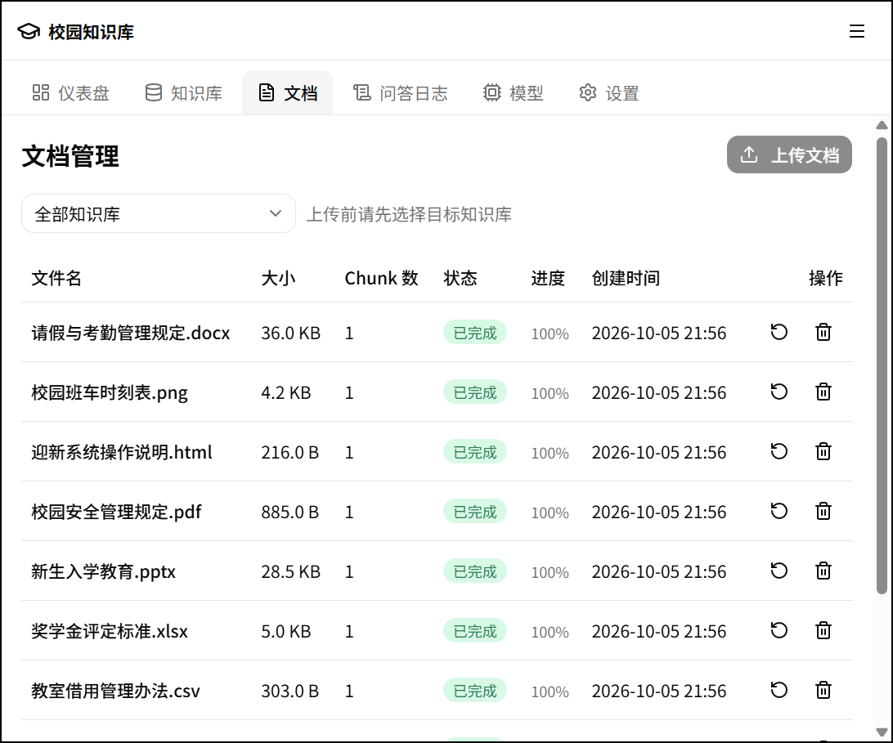
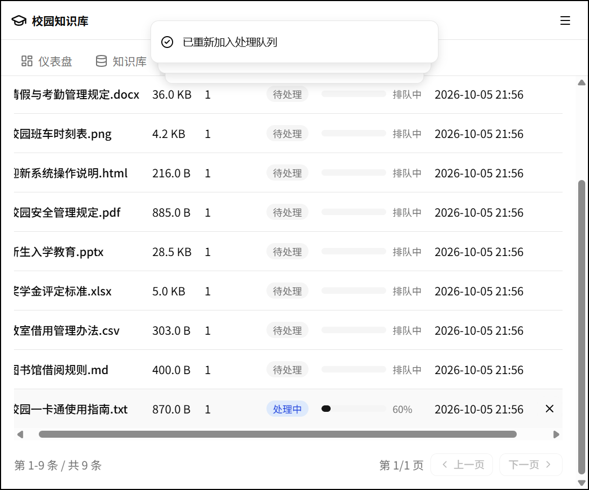
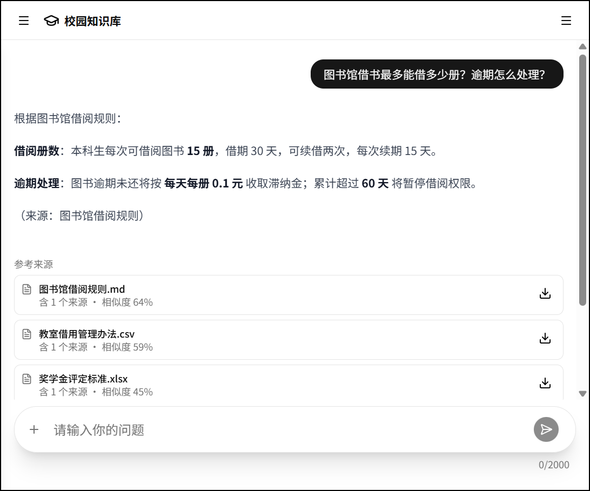
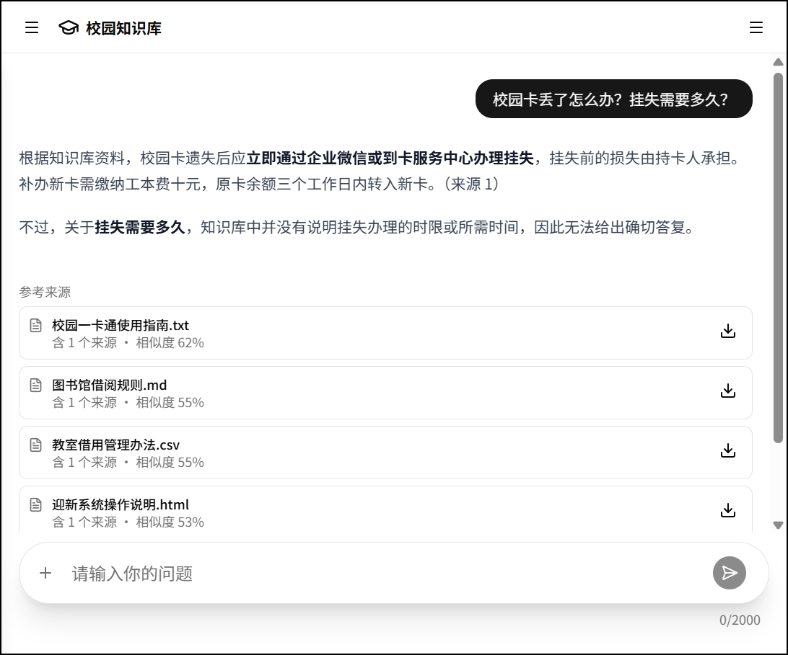
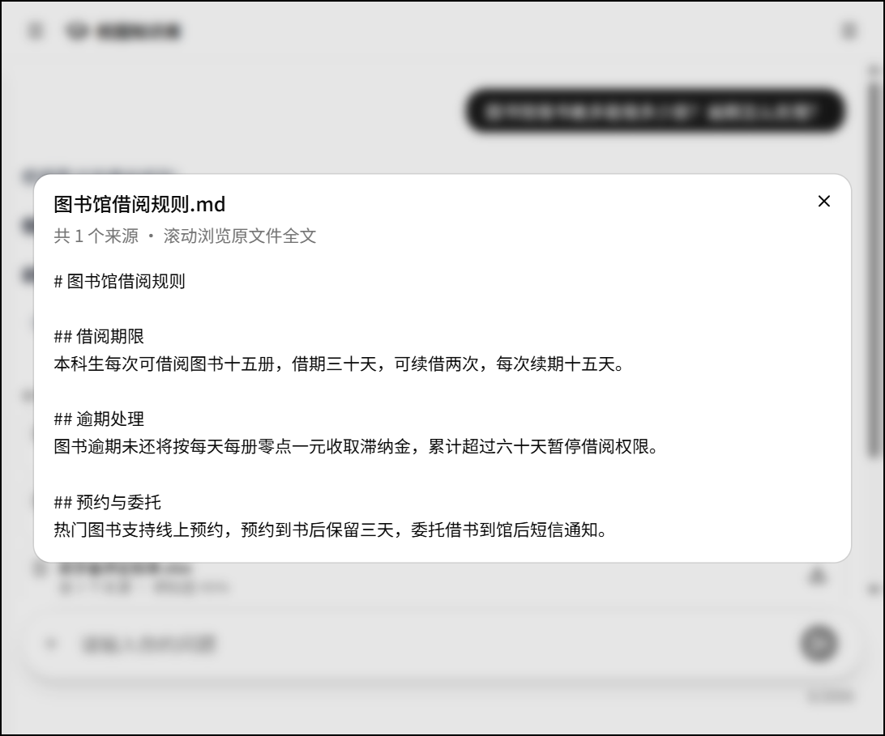

# 第5章 系统实现

本章按照功能页面介绍系统实现结果,重点展示实际运行截图。系统实现包括管理员登录、文档管理、聊天问答和来源预览,每项功能配一张截图并说明页面作用。

## 5.1 管理端功能实现

### 5.1.1 登录失败提示

管理员通过登录页面进入系统。系统只有一个管理员账户,登录时校验用户名和密码;密码错误时不进入管理页面,并在页面上给出提示。

图5-1 管理端登录失败提示

图5-1展示了输入错误密码后的登录页面,顶部提示“用户名或密码错误”,登录表单仍然保留,管理员可以重新输入凭证。

### 5.1.2 首次改密页面

首次登录时,管理员还需要完成密码初始化。图5-2展示了输入新密码和确认密码的页面,修改成功后才能进入管理功能。

图5-2 管理员首次改密页面

## 5.2 文档管理功能实现

### 5.2.1 文档列表页面

管理员登录后可以进入文档管理页面,选择知识库并上传文件。系统支持 PDF、DOCX、TXT、Markdown、CSV、XLSX、PPTX、HTML 和图片等格式,上传后由后台任务处理。

图5-3 管理端文档列表页面

图5-3展示了文档列表页面,列表中显示文件名、文件大小、切片数量、处理状态、进度、创建时间和操作按钮,管理员可以在同一页面查看文档当前状态。

### 5.2.2 文档入库进度页面

文档上传后由后台任务依次处理。图5-4展示了文档列表中的处理状态,管理员可以根据状态和进度判断文件是否正在排队或处理。

图5-4 文档入库进度页面

## 5.3 聊天问答功能实现

### 5.3.1 流式问答页面

用户进入聊天页面后,系统为其生成匿名客户端标识,不要求注册。用户在输入框中提交问题,系统从已完成入库的知识切片中检索相关内容,再调用生成模型组织回答。图5-5展示了聊天页面中的问答结果,用户问题位于页面右上方,回答区域按段落显示与图书馆借阅规则有关的内容,回答中的重点信息得到突出显示。

图5-5 聊天端问答页面

回答采用流式方式返回,文本随着模型生成逐步显示,用户可以在等待完整回答前看到已经生成的内容。

## 5.4 来源查看功能实现

### 5.4.1 来源列表

回答生成后,系统在消息下方列出本次回答使用的参考来源。来源卡片显示文件名、命中来源数量和相似度,用户可以据此判断回答来自哪些资料。

图5-6 问答来源列表

图5-6展示了来源列表,本次回答对应了图书馆借阅规则、教室借用管理办法和奖学金评定标准等文件。

### 5.4.2 引用文件预览页面

用户点击来源卡片后可以打开原始文件预览。图5-7展示了预览窗口中的文件名和原始内容,用户可以直接核对回答依据。

图5-7 引用文件预览页面

通过来源列表和原文预览,系统把回答内容与实际资料连接起来。用户可以先阅读回答,再点击来源核对原文;当知识库中没有达到阈值的相关切片时,系统返回拒答提示,不依据模型自身知识补写答案。

## 5.5 本章小结

本章以系统实际运行页面为依据,介绍了管理员登录与首次改密、文档管理、文档入库进度、聊天问答、来源列表和原文预览功能。截图展示了系统从文档管理到知识问答的主要操作结果,第6章将进一步说明测试环境、测试用例和测试结果。
